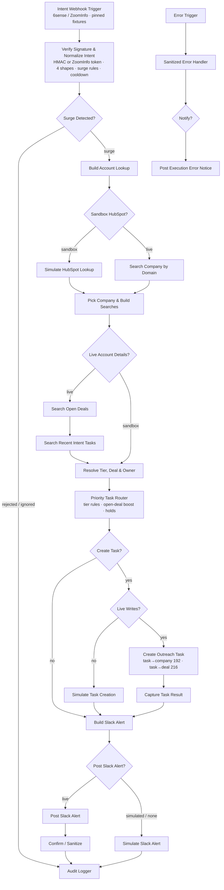

# n8n-6sense-zoominfo-intent-spike-hubspot-alert-engine

**Intent surges from 6sense or ZoomInfo → the matching HubSpot company and its tier → a high-priority outreach task for the right account executive → a Slack alert for tier-1 accounts.**

I built this n8n workflow for account-based teams that pay for intent data but act on it too late. When a target account starts researching your category, the surge usually sits in a dashboard until someone exports a list. This engine reacts to each surge as it arrives. It cleans up the domain, decides whether the spike is real, matches the account to a HubSpot company, reads the company's ABM tier, finds the open deal and the right owner, then creates a task with a due time that fits the tier. Tier-1 accounts, and hot tier-2 accounts, also get a Slack alert.

> **Safe by default.** `SANDBOX_MODE=true` and `DRY_RUN=true`. Out of the box, the workflow runs only against pinned fictional intent deliveries. It makes no HubSpot or Slack calls until you turn both switches off.

Built by DH Robin · dhRobin Systems · MIT licensed.

---

## Table of Contents

1. [Why this exists](#1-why-this-exists)
2. [Architecture](#2-architecture)
3. [Repository layout](#3-repository-layout)
4. [Quick start](#4-quick-start)
5. [Intent webhook payloads & authentication](#5-intent-webhook-payloads--authentication)
6. [Surge detection](#6-surge-detection)
7. [HubSpot account, tier & deal matching](#7-hubspot-account-tier--deal-matching)
8. [Task assignment rules](#8-task-assignment-rules)
9. [Slack alerts](#9-slack-alerts)
10. [Environment variables](#10-environment-variables)
11. [Node configuration](#11-node-configuration)
12. [Testing stages](#12-testing-stages)
13. [Security & privacy model](#13-security--privacy-model)
14. [Troubleshooting](#14-troubleshooting)
15. [Known limitations](#15-known-limitations)
16. [Disclaimer & license](#16-disclaimer--license)

---

## 1. Why this exists

Intent data is perishable. A buying committee researching "revenue intelligence" this week has often picked a shortlist two weeks later. The usual failure points:

- **Nobody owns the signal.** Surges show up in the intent platform, while AEs live in HubSpot.
- **Every spike looks the same.** A tier-3 account with a mild bump gets the same attention as a tier-1 account that just moved into the Decision stage.
- **Alerts go to the wrong person.** The company owner changed, or the open deal belongs to someone else.
- **Noise trains people to ignore alerts.** The same account fires every day, and personal email domains slip through.

I designed this engine to answer four questions for every surge: *Is it real? Is it one of ours? How important is it? Who acts, and by when?*

## 2. Architecture




| Required component | Nodes |
|---|---|
| 1 · Intent Webhook Trigger | `Intent Webhook Trigger` (raw body on, 7 pinned fictional deliveries, 12 accounts) |
| 2 · Signature Verification & Intent Normalizer | `Verify Signature & Normalize Intent` |
| 3 · HubSpot Account & Deal Tier Matching Engine | `Build Account Lookup`, `Search Company by Domain`, `Pick Company & Build Searches`, `Search Open Deals`, `Search Recent Intent Tasks`, `Resolve Tier, Deal & Owner` (sandbox: `Simulate HubSpot Lookup`) |
| 4 · Priority Task Router & Slack Alert Dispatcher | `Priority Task Router`, `Create Outreach Task`, `Build Slack Alert`, `Post Slack Alert` (dry run: the two simulators) |
| 5 · Audit Logger & Sanitized Error Handler | `Audit Logger`, `Sanitized Error Handler`, `Sanitize Slack Error` |

The sandbox and live paths come back together at the same nodes. Each simulator returns the shape of the real API response, so a sandbox run exercises the same matching, routing and logging code as production.

## 3. Repository layout

```
n8n-6sense-zoominfo-intent-spike-hubspot-alert-engine/
├── README.md        ← this file
├── workflow.json    ← import into n8n (inactive, sandbox defaults, pinned fixtures)
├── DISCLAIMER.md
└── LICENSE          ← MIT
```

All logic lives in Code nodes inside `workflow.json`. There are no community nodes and no stored n8n credentials. Every secret comes from an environment variable.

## 4. Quick start

1. In n8n, go to **Workflows → Import from File** and select `workflow.json`. The workflow imports **inactive**.
2. Open it and click **Execute Workflow**. The trigger replays 7 pinned fictional deliveries.
3. Open **Audit Logger**. You should see 12 records that match the table in [Stage 1](#stage-1--sandbox-pinned-fixtures-no-network).
4. Open **Simulate Task Creation (Dry Run)** and **Build Slack Alert** to read the tasks and Block Kit messages that would have gone out.

### n8n platform prerequisites

| Setting | Why |
|---|---|
| `N8N_BLOCK_ENV_ACCESS_IN_NODE=false` | Code nodes read configuration through `$env`. If access is blocked, every helper falls back to the safe default (sandbox + dry run). |
| `NODE_FUNCTION_ALLOW_BUILTIN=crypto` | Needed for HMAC and constant-time comparison. Without it, every delivery is rejected (`crypto_module_unavailable`). |
| Concurrency of 1 for this workflow | The cooldown ledger in static data isn't transactional. |
| Settings → Error Workflow = this workflow | Activates the sanitized error branch. |

## 5. Intent webhook payloads & authentication

### 5.1 How intent reaches the webhook (read this first)

I checked both providers before writing the verifier, and neither sends an HMAC-signed intent-surge webhook:

- **ZoomInfo webhooks** are company and contact **Update** subscriptions with up to 25 records per delivery. They authenticate with a static verification token in the `x-zoominfo-token` header, and nothing is computed over the body. Intent signals themselves come from ZoomInfo's Intent API (topic, category, `signalScore`, `audienceStrength`, `signalDate`, `trend`, `newSignal`, company).
- **6sense** exposes buying stage, intent score and intent keywords through its CRM integrations and orchestration tools. I couldn't confirm a native, signed 6sense intent webhook.

So the default design is: a **relay** (your iPaaS, a small cloud function, or an intent-polling job) collects surges from 6sense or the ZoomInfo Intent API, signs each delivery with HMAC-SHA256, and posts it here. For ZoomInfo's own webhooks, you can opt in to the token check instead (5.3).

### 5.2 Accepted payload shapes

The normalizer detects the shape automatically. Each delivery can carry several accounts; each account becomes one item (`MAX_ACCOUNTS_PER_DELIVERY`, default 25).

**B · ZoomInfo Intent API records (relayed)**: the same `attributes` the Intent API returns, grouped by company:

```json
{
  "deliveryId": "relay-zi-0001",
  "source": "zoominfo",
  "data": [
    { "id": "zi-intent-5550001-412", "type": "Intent", "attributes": {
        "category": "Sales", "topic": "Revenue Operations", "signalScore": 92, "audienceStrength": "A",
        "newSignal": true, "signalDate": "2026-11-16", "trend": 18, "recommendedContacts": [],
        "company": { "id": 5550001, "name": "Northwind Fixture Traders", "website": "http://www.northwind-fixture.example" } } }
  ]
}
```

**C · 6sense relay**: map your 6sense account fields into this shape in the relay:

```json
{
  "deliveryId": "relay-6s-0002",
  "source": "6sense",
  "accounts": [
    { "accountId": "6s-fixture-302", "name": "Contoso Fixture Ltd", "domain": "contoso-fixture.example",
      "buyingStage": "Decision", "previousBuyingStage": "Consideration",
      "intentScore": 78, "previousIntentScore": 61, "profileFit": "Strong",
      "intentKeywords": [ { "keyword": "revenue intelligence", "score": 81, "previousScore": 66 }, { "keyword": "sales forecasting software", "score": 74 } ],
      "updatedAt": "2026-11-16T03:00:00Z" }
  ]
}
```

`intentKeywords` may also be plain strings, in which case each keyword takes the account `intentScore`.

**D · Normalised relay format**: for any other source (Bombora via a relay, G2, your own model):

```json
{ "deliveryId": "relay-norm-0006", "source": "relay", "events": [
  { "accountName": "Proseware Fixture Systems", "domain": "proseware-fixture.example",
    "accountScore": 93, "previousAccountScore": 70, "buyingStage": "Decision", "previousBuyingStage": "Consideration",
    "topics": [ { "topic": "Conversation Intelligence", "score": 93, "isNew": true, "strength": "A" } ],
    "observedAt": "2026-11-16T05:00:00Z" } ] }
```

**A · ZoomInfo webhook envelope (direct)**: `{ "webhookDetails": {...}, "data": [ company records ] }`. Each record's `website` gives the domain, and intent is read from `intentSignals`, `intent` or `topics` (same field names as the Intent API). Records without intent fields are ignored as `no_tracked_intent`. A standard company Update subscription carries firmographic changes, so check what your subscription actually delivers before relying on this shape.

Normalisation rules:

- **Domain:** lower case; protocol, `www.`, path, port and e-mail local part removed (`WWW.Woodgrove-Fixture.example` → `woodgrove-fixture.example`, `someone@gmail.com` → `gmail.com`).
- **Scores:** clamped to 0–100 and rounded.
- **Delta:** `score − previousScore`. When there's no previous score, ZoomInfo's `trend` is used as the change. That's my interpretation of `trend`, so confirm it against your ZoomInfo documentation.
- **Stages:** ordered Target < Awareness < Consideration < Decision < Purchase.

### 5.3 Authentication (fails closed)

| `INTENT_AUTH_MODES` value | Checks | Use when |
|---|---|---|
| `hmac_sha256` (live default) | `X-Intent-Signature: sha256=<hex>` equals HMAC-SHA256(`INTENT_WEBHOOK_SECRET`, `"<X-Intent-Timestamp>.<raw body>"`), and the timestamp is within `INTENT_SIGNATURE_TOLERANCE_SECONDS` (300) | Your relay posts surges |
| `zoominfo_token` (opt-in) | `x-zoominfo-token` equals `ZOOMINFO_WEBHOOK_TOKEN` (constant-time) | ZoomInfo posts directly |

Use `INTENT_AUTH_MODES=hmac_sha256,zoominfo_token` to accept both. The sandbox enables both, so the ZoomInfo fixture runs. The timestamp window is enforced only outside the sandbox, because the fixtures carry fixed timestamps.

Signing in the relay (Node.js):

```js
const ts = Math.floor(Date.now() / 1000).toString();
const raw = JSON.stringify(payload);
const sig = crypto.createHmac('sha256', process.env.INTENT_WEBHOOK_SECRET).update(`${ts}.${raw}`).digest('hex');
// POST raw with headers: X-Intent-Timestamp: ts, X-Intent-Signature: `sha256=${sig}`, X-Intent-Delivery-Id: <unique id>
```

Rejections: `signature_header_missing`, `timestamp_header_missing`, `signature_mismatch`, `timestamp_outside_tolerance`, `webhook_secret_not_configured`, `zoominfo_token_mismatch`, `zoominfo_token_not_configured`, `crypto_module_unavailable`.

A static ZoomInfo token proves the sender knows the token. It doesn't protect the body or stop replays, and the 72-hour cooldown is what makes replays harmless. If that's not enough, route ZoomInfo through your relay and use HMAC.

## 6. Surge detection

An account is a **surge** when at least one of these holds:

| Rule | Default |
|---|---|
| A tracked topic scores ≥ `INTENT_SCORE_THRESHOLD` **and** is new or rose ≥ `MIN_SCORE_DELTA` | 70 and 15 |
| The buying stage advanced **into** one of `SURGE_BUYING_STAGES` | `Decision,Purchase` |
| The account intent score is ≥ the threshold and rose ≥ `MIN_SCORE_DELTA` | — |

`TRACKED_TOPICS` (comma-separated, case-insensitive) limits topics to your configured set. If you leave it empty, every topic counts.

Filters before HubSpot is touched:

| Check | Ignored as |
|---|---|
| Unparseable domain | `domain_missing_or_invalid` |
| Free mailbox domains and `EXCLUDED_DOMAINS` (put your own domain here) | `excluded_domain` |
| No topic, score or stage | `no_tracked_intent` |
| Not a surge | `below_surge_threshold` |
| Alerted within `ALERT_COOLDOWN_HOURS` (72) | `cooldown_active` |

**Escalation beats cooldown.** A repeat surge inside the cooldown still goes through, marked `escalated`, if the buying stage moved past the last alerted stage or the peak score rose by at least `MIN_SCORE_DELTA` since the last alert. The cooldown starts only after a task was actually created (or, for alert-only accounts, after Slack accepted the alert). A failed task write never starts it, so the next surge can retry.

## 7. HubSpot account, tier & deal matching

### 7.1 Company lookup

`POST /crm/v3/objects/companies/search` with three OR'd filter groups: `domain EQ d`, `domain EQ www.d`, and `hs_additional_domains CONTAINS_TOKEN d`. Candidates are then checked in code:

1. An exact primary domain (or `website`) match ranks above an additional-domain match.
2. Ties are broken by: tier set, then `hs_is_target_account = true`, then has an owner, then has open deals.
3. If two companies share the same primary domain, the best one is used and the Slack alert asks you to check for duplicates.

Unknown domains are **logged, never created**. An intent signal isn't a reason to create CRM records. If you want alerts for strong unknown accounts, set `UNKNOWN_ACCOUNT_ALERT_SCORE` (for example `90`).

### 7.2 Tier

HubSpot's ABM tools add two company properties: **Target account** (`hs_is_target_account`) and **Ideal Customer Profile Tier** (`hs_ideal_customer_profile`, Tier 1–3). The engine reads `HUBSPOT_TIER_PROPERTY` (default `hs_ideal_customer_profile`) and maps its value with `TIER_VALUE_MAP_JSON`:

```json
{ "tier_1": "tier_1", "tier_2": "tier_2", "tier_3": "tier_3", "tier 1": "tier_1", "tier 2": "tier_2", "tier 3": "tier_3" }
```

If you use your own tier property (for example `abm_tier` with values `Strategic`, `Core`, `Nurture`), point `HUBSPOT_TIER_PROPERTY` at it and map `{"strategic":"tier_1","core":"tier_2","nurture":"tier_3"}`. Matching is case-insensitive. A target account with no tier gets `UNTIERED_TARGET_ACCOUNT_TIER` (default `tier_2`). Everything else is `untiered`.

### 7.3 Deal & owner

- **Open deal:** `POST /crm/v3/objects/deals/search` with `associations.company EQ <companyId>` and `hs_is_closed EQ false` (optionally limited by `HUBSPOT_DEAL_PIPELINE_IDS`), sorted by `hs_lastmodifieddate` descending. The most recently touched open deal wins.
- **Owner order:** open-deal owner → company owner → `FALLBACK_OWNER_ID` (for example an SDR queue user). The deal owner comes first, because the person working the live opportunity should hear that the account is researching again.
- **Existing task:** `POST /crm/v3/objects/tasks/search` for open tasks on the company created within `TASK_DEDUPE_DAYS` (7). If one's subject starts with `TASK_SUBJECT_PREFIX` (`Intent spike:`), no second task is created.

### 7.4 Private app scopes

`crm.objects.companies.read`, `crm.objects.deals.read`, `crm.objects.contacts.write` (tasks are created through the CRM objects API; check your portal's scope list for tasks), plus read access to tasks for the dedupe search.

## 8. Task assignment rules

### 8.1 Default tier rules (`TIER_RULES_JSON`)

```json
{
  "tier_1":   { "task": true,  "priority": "HIGH",   "type": "CALL",  "dueHours": 4,  "slack": "always" },
  "tier_2":   { "task": true,  "priority": "MEDIUM", "type": "EMAIL", "dueHours": 24, "slack": "when_hot" },
  "tier_3":   { "task": false, "priority": "LOW",    "type": "TODO",  "dueHours": 72, "slack": "never" },
  "untiered": { "task": false, "priority": "LOW",    "type": "TODO",  "dueHours": 72, "slack": "never" }
}
```

- **"Hot"** means a stage surge into Decision/Purchase, a peak score ≥ `SLACK_HOT_SCORE` (90), an open deal, or an escalated repeat.
- **Open-deal boost:** an open deal lifts the task priority to HIGH (`OPEN_DEAL_PRIORITY_BOOST=true`).
- **Holds:** no task is created when an open intent task already exists, or when no owner can be found. In the no-owner case, tier-1 and tier-2 accounts still get a Slack alert so a person can assign it.
- **Lookup failures** create no task, and an ops alert is sent instead.

### 8.2 The task

`POST /crm/v3/objects/tasks`:

```json
{
  "properties": {
    "hs_timestamp": "2026-11-16T07:08:13.774Z",
    "hs_task_subject": "Intent spike: Northwind Fixture Traders · Revenue Operations (92)",
    "hs_task_body": "<p><b>zoominfo intent surge</b> for Northwind Fixture Traders … <b>Suggested next step:</b> …</p>",
    "hs_task_status": "NOT_STARTED",
    "hs_task_priority": "HIGH",
    "hs_task_type": "CALL",
    "hubspot_owner_id": "YOUR_OWNER_ID"
  },
  "associations": [
    { "to": { "id": "COMPANY_ID" }, "types": [ { "associationCategory": "HUBSPOT_DEFINED", "associationTypeId": 192 } ] },
    { "to": { "id": "DEAL_ID" },    "types": [ { "associationCategory": "HUBSPOT_DEFINED", "associationTypeId": 216 } ] }
  ]
}
```

`hs_timestamp` is the due time. The body lists why the account surged, the stage transition, the top topics with scores, deltas and audience strength, the open deal, and a suggested next step that fits the stage. The create call is **never auto-retried**, so a timeout can't produce duplicate tasks. Association type IDs 192 (task → company) and 216 (task → deal) are HubSpot-defined defaults. Confirm them in your portal with `GET /crm/v4/associations/tasks/companies/labels` if a create fails on associations.

### 8.3 Fixture outcomes

| Account | Tier | Situation | Result |
|---|---|---|---|
| Northwind | 1 | 2 surging ZoomInfo topics, open deal owned by another AE | HIGH CALL task to the **deal owner**, due in 4 h · Slack |
| Contoso | 2 | 6sense Consideration → Decision | MEDIUM EMAIL task to the company owner, due in 24 h · Slack (stage surge) |
| Proseware | untiered target → 2 | New topic at 93 | MEDIUM task · Slack (hot) |
| Woodgrove | 1 | No owner anywhere | HIGH CALL task to `FALLBACK_OWNER_ID` · Slack |
| Adatum | 1 | Open intent task already exists | No new task · Slack only |
| Fabrikam | 3 | Real surge | Log only |
| Tailspin | not in HubSpot | Real surge | Log only |

## 9. Slack alerts

`Build Slack Alert` posts Block Kit to `SLACK_WEBHOOK_URL`. Each alert has:

- A header with 🔥 for tier 1 and 📈 for others.
- Fields for account and domain, tier and source, peak intent, buying-stage transition, open deal, and owner with how it was chosen.
- The top topics with scores, deltas and 🆕 markers.
- The task line ("Created HIGH CALL task, due …") or the hold reasons, plus duplicate-company and write-failure warnings.
- Buttons for the company and the deal.
- A context line with the surge reasons and the run ID.

To @-mention owners, set `SLACK_OWNER_MAP_JSON` to `{"<HubSpot owner ID>": "<Slack member ID>"}`. Incoming webhooks can't look up users by e-mail, so the map is explicit. Alerts contain account-level data only, never contact names, e-mails or phone numbers.

## 10. Environment variables

Copy this block into your n8n environment and replace every placeholder.

```bash
# ── Safety switches (both must be "false" before anything is written) ──
SANDBOX_MODE=true
DRY_RUN=true

# ── Intent webhook ──
INTENT_WEBHOOK_SECRET=YOUR_WEBHOOK_SECRET
# hmac_sha256 (relay) and/or zoominfo_token (ZoomInfo direct), comma-separated
INTENT_AUTH_MODES=hmac_sha256
ZOOMINFO_WEBHOOK_TOKEN=YOUR_ZOOMINFO_WEBHOOK_TOKEN
INTENT_SIGNATURE_HEADER=x-intent-signature
INTENT_TIMESTAMP_HEADER=x-intent-timestamp
INTENT_SIGNATURE_TOLERANCE_SECONDS=300
MAX_ACCOUNTS_PER_DELIVERY=25

# ── Surge rules ──
INTENT_SCORE_THRESHOLD=70
MIN_SCORE_DELTA=15
SURGE_BUYING_STAGES=Decision,Purchase
# Empty = every topic counts
TRACKED_TOPICS=
ALERT_COOLDOWN_HOURS=72
EXCLUDED_DOMAINS=YOUR_COMPANY_DOMAIN.example

# ── HubSpot ──
HUBSPOT_ACCESS_TOKEN=YOUR_HUBSPOT_PRIVATE_APP_TOKEN
HUBSPOT_PORTAL_ID=YOUR_HUBSPOT_PORTAL_ID
HUBSPOT_API_BASE_URL=https://api.hubapi.com
HUBSPOT_APP_BASE_URL=https://app.hubspot.com
HUBSPOT_TIER_PROPERTY=hs_ideal_customer_profile
TIER_VALUE_MAP_JSON=
UNTIERED_TARGET_ACCOUNT_TIER=tier_2
HUBSPOT_DEAL_PIPELINE_IDS=
FALLBACK_OWNER_ID=YOUR_FALLBACK_OWNER_ID
TASK_SUBJECT_PREFIX=Intent spike:
TASK_DEDUPE_DAYS=7

# ── Routing ──
# One line of JSON, see section 8.1 (empty = defaults)
TIER_RULES_JSON=
OPEN_DEAL_PRIORITY_BOOST=true
SLACK_HOT_SCORE=90
# 0 = never alert on accounts that aren't in HubSpot
UNKNOWN_ACCOUNT_ALERT_SCORE=0

# ── Slack (optional) ──
SLACK_WEBHOOK_URL=YOUR_SLACK_WEBHOOK_URL
SLACK_OWNER_MAP_JSON=
SLACK_NOTIFY_ON_MONITOR_ERROR=true

# ── Audit ──
AUDIT_LOG_TO_STDOUT=true
AUDIT_RING_BUFFER_SIZE=500

# ── n8n platform ──
N8N_BLOCK_ENV_ACCESS_IN_NODE=false
NODE_FUNCTION_ALLOW_BUILTIN=crypto
```

Flags accept only `true/1/yes/on` or `false/0/no/off`. Anything else keeps the safe default. Values starting with `YOUR_` are treated as unset where it matters (for example `FALLBACK_OWNER_ID`). Keep comments on their own lines, because Docker env files don't support inline comments.

## 11. Node configuration

| Node | Type | Key settings |
|---|---|---|
| Intent Webhook Trigger | Webhook v2 | POST `intent-spike` · Respond immediately · **Raw Body on** |
| Verify Signature & Normalize Intent | Code v2, all items | auth, shape detection, fan-out, surge rules, cooldown |
| Surge Detected? / Sandbox HubSpot? / Live Account Details? / Create Task? / Live Writes? / Post Slack Alert? | IF v2.2 | strict, case-sensitive |
| Build Account Lookup / Pick Company & Build Searches / Resolve Tier, Deal & Owner / Priority Task Router | Code v2, each item | see sections 7–8 |
| Search Company by Domain / Search Open Deals / Search Recent Intent Tasks | HTTP Request v4.2 | `Authorization: Bearer {{$env.HUBSPOT_ACCESS_TOKEN}}` · full response · never error · 3 tries |
| Create Outreach Task | HTTP Request v4.2 | POST · **no auto-retry** |
| Build Slack Alert → Post Slack Alert | Code v2 + HTTP Request v4.2 | `continueErrorOutput` → Sanitize Slack Error |
| Audit Logger | Code v2, each item | redacted record · stdout · `intentAudit` ring buffer · `intentAlertLedger` (live only) |
| Error Trigger → Sanitized Error Handler | Error Trigger v1 + Code v2 | redacted summary, optional Slack notice |

## 12. Testing stages

### Stage 1 · Sandbox (pinned fixtures, no network)

`SANDBOX_MODE=true`, `DRY_RUN=true`. Execute the workflow and compare the 12 Audit Logger records:

| Delivery | Account | Expected |
|---|---|---|
| `relay-zi-0001` | northwind-fixture.example | surge · tier 1 · deal owner · `task_and_alert` · HIGH |
| `relay-zi-0001` | litware-fixture.example | ignored · `below_surge_threshold` (71, +5) |
| `relay-6s-0002` | contoso-fixture.example | surge · tier 2 · Consideration → Decision · `task_and_alert` · MEDIUM |
| `relay-6s-0002` | fabrikam-fixture.example | surge · tier 3 · `log_only` |
| `relay-6s-0002` | tailspin-fixture.example | surge · `not_found` · `log_only` |
| `zi-webhook-fixture-03` | adatum-fixture.example | `zoominfo_token` · tier 1 · existing task · `alert_only` |
| `relay-norm-0004` | woodgrove-fixture.example | tier 1 · fallback owner · `task_and_alert` · HIGH |
| `relay-norm-0004` | gmail.com | ignored · `excluded_domain` |
| `relay-norm-0004` | northwind-fixture.example | ignored · `cooldown_active` |
| `relay-norm-0005` | — | rejected · `signature_mismatch` |
| `relay-norm-0006` | proseware-fixture.example | untiered target → tier 2 · hot · `task_and_alert` · MEDIUM |
| `relay-bad-0007` | — | ignored · `unrecognised_payload_shape` |

All company names, domains (`*.example`), IDs, owners, scores and secrets in the fixtures are fictional.

### Stage 2 · Shadow (real lookups, writes simulated)

`SANDBOX_MODE=false`, `DRY_RUN=true`, against a **HubSpot test account or sandbox**:

1. Create test companies with domains you control, set Target account and ICP tier, add an open deal to one, and set owners.
2. Sign a test delivery with your relay (or the snippet in 5.3) and post it.
3. Check `Pick Company & Build Searches`, `Resolve Tier, Deal & Owner` and `Simulate Task Creation (Dry Run)`. Nothing is written, and Slack is simulated.
4. Post the same delivery again within the tolerance window. Because nothing went out in dry run, the cooldown doesn't start yet.

### Stage 3 · Live in the test portal

`DRY_RUN=false`. Confirm the tasks appear on the company and deal timelines with the right owner, priority and due time. Check that Slack alerts post for tier 1, that a repeat delivery is ignored as `cooldown_active`, and that a stale timestamp is rejected. Make the workflow its own **Error Workflow** and force a failure (an invalid token) to see the sanitized notice.

### Stage 4 · Production

Start with `TRACKED_TOPICS` set to your 5–10 core topics and tier-1 accounts only (set `tier_2.task` to `false`). Watch a week of alerts with your AEs before widening.

## 13. Security & privacy model

- **No secrets in the workflow.** Every key comes from `$env`. The JSON contains only placeholders and clearly fictional sandbox values, which are used only while `SANDBOX_MODE=true`.
- **Fails closed.** A missing secret, header, timestamp or `crypto` module rejects the delivery before any lookup. In live mode only HMAC is accepted unless you opt in to the ZoomInfo token.
- **Replay protection.** Signed timestamps (±300 s) plus a per-domain cooldown.
- **No record creation from intent.** Unknown domains are logged, never created.
- **Account-level data only.** Intent is company research activity. The engine handles domains, company names, topics and scores, never contact names, e-mails or phone numbers. ZoomInfo's `recommendedContacts` are ignored.
- **Redacted logs.** The audit record holds IDs, domains, tiers, scores and enums. Keys matching `authorization|token|secret|password|api key|cookie|signature|webhook url` are replaced, and known secret values, Bearer tokens, HubSpot `pat-` tokens, Slack webhook URLs and signed URL parameters are scrubbed from every string.
- **Sanitized errors.** The error branch drops stack traces, request options and bodies.
- **Restrict n8n execution data.** Executions contain the full delivery. Limit who can open them, and set a retention period.

## 14. Troubleshooting

| Symptom | Likely cause | Fix |
|---|---|---|
| Every delivery `signature_mismatch` | The relay signs a re-serialised body, or uses a different secret | Sign the exact bytes you send; keep **Raw Body** on in the trigger |
| `timestamp_outside_tolerance` | Relay clock drift, or a retry of an old delivery | Sync the clock (NTP); re-sign retries |
| ZoomInfo deliveries rejected (`signature_header_missing`) | `zoominfo_token` not enabled | `INTENT_AUTH_MODES=hmac_sha256,zoominfo_token` |
| `no_tracked_intent` on ZoomInfo webhooks | The company Update payload carries no intent fields | Relay Intent API results instead (shape B) |
| Everything `below_surge_threshold` | Threshold too high, or no previous scores sent | Send `previousScore`/`trend`, or lower `INTENT_SCORE_THRESHOLD` |
| Account `not_found` though it exists | The domain differs (subsidiary, regional TLD) | Add it to the company's additional domains |
| Wrong tier | Custom tier values not mapped | Set `HUBSPOT_TIER_PROPERTY` and `TIER_VALUE_MAP_JSON` |
| Task create 400 on associations | Association type IDs differ | Check with `/crm/v4/associations/tasks/companies/labels` |
| Task create 400 on owner | The owner is deactivated | Reassign the company/deal owner, or set `FALLBACK_OWNER_ID` |
| Same account every day | Cooldown too short, or a task failed (failures never start it) | Raise `ALERT_COOLDOWN_HOURS`; fix the write error |

## 15. Known limitations

- **No native signed intent webhook** from either provider, so HMAC relies on your relay. ZoomInfo direct uses a static token.
- **`trend` as delta** is my interpretation of ZoomInfo's field. Confirm it against your data.
- **Due times are wall-clock.** `dueHours` doesn't skip nights or weekends.
- **Owner names** aren't looked up. Slack shows the owner ID unless `SLACK_OWNER_MAP_JSON` maps it to a mention.
- **No company property write-back.** Writing the last surge date or topics to the company is a natural extension, but it isn't included.
- **Static data isn't transactional.** Keep concurrency at 1.

---

## 16. Disclaimer & license

### ⚠️ Disclaimer & Liability Limitation

Use at your own risk. The code, workflows, and scripts in this repository (`n8n-6sense-zoominfo-intent-spike-hubspot-alert-engine`) are provided for educational and architectural demonstration purposes.

* **No Liability:** The author and dhRobin Systems accept no responsibility or liability for any direct, indirect, incidental, or consequential damages that result from using, misusing, or deploying these scripts. That includes missed, late, duplicated or misrouted intent alerts and tasks, and any record created or changed in a connected system.
* **No Warranty:** All software, n8n JSON blueprints and JavaScript modules are provided "AS IS", without warranty of any kind, express or implied. This includes, but is not limited to, warranties of merchantability, fitness for a particular purpose, and non-infringement.
* **Production Testing Required:** Always test thoroughly in an isolated staging environment, such as a HubSpot developer test account or sandbox and a test Slack channel, with `SANDBOX_MODE=true` and `DRY_RUN=true` enabled, before you connect live HubSpot, 6sense, ZoomInfo or Slack credentials. Treat every intent surge as a research signal that a person must judge before acting on it, not as a confirmed buying decision.
* **Third-Party APIs & Compliance:** You alone are responsible for complying with the terms of service, rate limits, data privacy regulations (GDPR/CCPA), data-licensing terms, and security policies of 6sense, ZoomInfo, HubSpot, Slack and any connected services. That includes confirming your intent-data licence allows this use, keeping personal data out of alerts and tasks, respecting outreach and anti-spam rules, and reviewing every automatically created or updated record.

The full disclaimer is also available in [DISCLAIMER.md](https://github.com/dhrobinsystems/n8n-6sense-zoominfo-intent-spike-hubspot-alert-engine/blob/main/DISCLAIMER.md).

### License

Released under the MIT License. Copyright (c) 2026 DH Robin (dhRobin Systems). See [LICENSE](https://github.com/dhrobinsystems/n8n-6sense-zoominfo-intent-spike-hubspot-alert-engine/blob/main/LICENSE).

---

Full text: DISCLAIMER.md · Licensed under the MIT License. License: MIT © 2026 DH Robin (dhRobin Systems) · Provided as-is, see the disclaimer.
